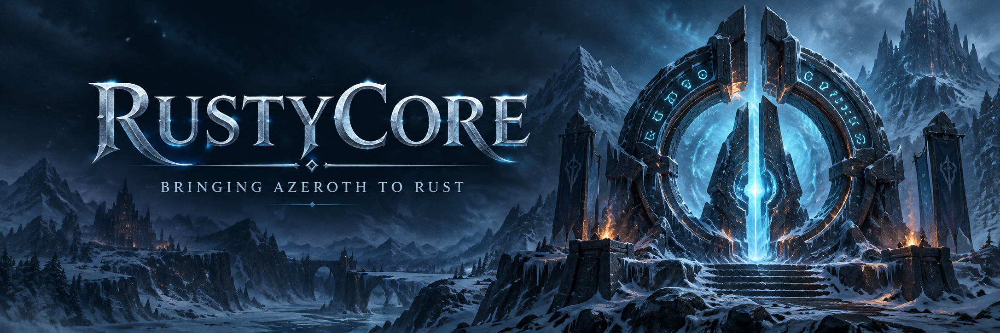

<p align="center">
  
</p>

<p align="center">
  <strong>RustyCore · Forever</strong><br>
  A Rust server for WoW Forever 1.60.1, build 70170, Beta x64.
</p>

<p align="center">
  <a href="LICENSE"></a>
  <a href="https://www.rust-lang.org/"></a>
  
  <a href="https://discord.gg/mH6ACpGPb2"></a>
</p>

<p align="center">
  <a href="#current-status">Status</a> ·
  <a href="#extractor">Extractor</a> ·
  <a href="#build-and-test">Build & test</a> ·
  <a href="#documentation">Documentation</a> ·
  <a href="#community">Community</a>
</p>

## What is RustyCore Forever?

RustyCore Forever is the modern-client development branch of
[RustyCore](https://github.com/alseif0x/rustycore). It reuses the modular
`3.4.3` foundation while implementing the WoW Forever `1.60.1.70170` protocol.

The `forever` and `3.4.3` branches have different client targets. Forever fixes
and pull requests belong in `forever`; matching older behavior is not enough
when the modern client requires something different.

## Current status

The original Forever work is now integrated with the modular foundation. The
November 1 integration passed its final local acceptance, including architecture,
navigation, terrain, database and protocol checks. Subsequent experimental
creation and ownership changes retain their separate acceptance status in the
current-state checkpoint.

That is useful progress, but **the server is not playable yet**.

| Area | Where we are |
| --- | --- |
| Battle.net authentication | Real build-70170 authentication, account queries and realm-list exchange work in the isolated fixture |
| World connection | The client completes the target AuthSession proof and encrypted transport in the isolated probe |
| Character screen | Empty selection and the creation/customization UI have been observed with the real client |
| Character creation | Durable creation, saving and nonempty enumeration are not finished |
| World entry | Initial world loading and normal gameplay remain open |
| Modular integration | Final local acceptance passes; this is not full-world or gameplay acceptance |

For exact evidence and remaining work, read [Current state](docs/migration/STATE.md).

## Extractor

RustyCore also has a dedicated extraction project:
**[rustycore-extractors](https://github.com/alseif0x/rustycore-extractors/tree/forever)**.

Its `forever-extractor` CLI reads a local client and produces versioned DB2,
GameTable, camera, terrain, collision and navigation packages. Packages can be
verified offline before RustyCore consumes them.

The extractor already has bounded real packages and navigation readers. It does
**not** yet provide complete client extraction or full-world resources.

Use the extractor's [build and usage guide](https://github.com/alseif0x/rustycore-extractors/blob/forever/README.md#build-the-rust-product).

### Required checkout layout

The RustyCore workspace resolves sibling path dependencies even when optional
extractor features are disabled. Keep both repositories under the same parent:

```text
parent/
├── rustycore/
└── rustycore-extractors/
```

The reviewed extractor revision is
`d8f4044f63f4d47fcb44d655d11cea90889ec8ea`:

```bash
git clone https://github.com/alseif0x/rustycore-extractors.git ../rustycore-extractors
git -C ../rustycore-extractors checkout d8f4044f63f4d47fcb44d655d11cea90889ec8ea
```

Inspect an existing checkout instead of replacing local work.

## Build and test

Install the pinned Rust toolchain and `protoc` 28.3, then build the Battle.net
server with one Cargo job:

```bash
PROTOC=/path/to/protoc cargo build --locked --release -j1 -p bnet-server
```

Provision a **fresh disposable Auth database** and private TLS/configuration
material using the [Forever runbook](docs/operations/forever-login.md). Do not
point the fixture at a shared realm database.

```bash
RUST_LOG=warn ./target/release/bnet-server \
  --config /absolute/path/to/private-runtime/bnetserver.conf
```

In another terminal, run the authentication smoke test:

```bash
python3 tools/wow-test-bot/forever_bnet_smoke.py \
  --runtime /absolute/path/to/private-runtime
```

The fixture is loopback-only and the test realm stays offline. No character is
created and no world is joined. There is no published default password.

The current modular integration also passes `validation-v2 final`. Its verified
manifest and focused test results are linked from [Current state](docs/migration/STATE.md).

## Documentation

- [Forever runbook](docs/operations/forever-login.md) — isolated fixture, protocol evidence and current blockers
- [Current state](docs/migration/STATE.md) — implementation status and acceptance evidence
- [Extractor guide](https://github.com/alseif0x/rustycore-extractors/blob/forever/README.md) — build, extract and verify resources
- [Validation V2](docs/operations/validation-v2.md) — local checks and acceptance profiles
- [Documentation map](docs/README.md) — maintained project references
- [Inherited server setup](docs/wiki/server/setup.md) — 3.4.3 foundation, not a verified Forever world setup

## Community and contributing

Code, tests, protocol evidence, documentation and bug reports are welcome.
Start with [CONTRIBUTING.md](CONTRIBUTING.md), then check the current state before
choosing a task. Protocol and gameplay changes need a target C++ source anchor
or real client capture.

Join the [Discord community](https://discord.gg/mH6ACpGPb2) or open a
[GitHub issue](https://github.com/alseif0x/rustycore/issues). Keep credentials,
private configuration and client-derived data out of issues and pull requests.

## License

RustyCore is licensed under **GPL-3.0-or-later**. See [LICENSE](LICENSE) and
[NOTICE](NOTICE) for the license grant and attribution notices.

World of Warcraft belongs to Blizzard Entertainment. This project is not
affiliated with, endorsed by, or sponsored by Blizzard Entertainment.
